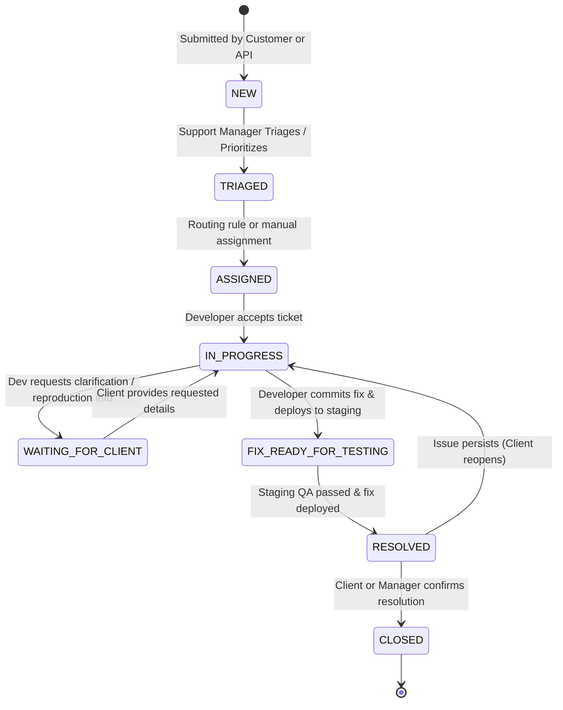

# Client Bug Tracker — System Architecture & Specification

## 1. Executive Summary

The **Client Bug Tracker** is a production-minded multi-tenant SaaS application built for a web development agency managing digital experiences for multiple brands. It bridges external clients reporting website defects and an internal development agency orchestrating triage, resolution, deployment, and Slack notifications.

The system enforces strict data boundaries:
- **Client Organization Isolation:** Clients can only inspect bug reports originating from their designated brand.
- **Privacy Partitioning:** Internal developer discussions, root-cause notes, and developer assignments are segregated from client visibility.
- **Auditable Lifecycle:** Every transition, assignment change, status change, and notification is recorded in an immutable audit ledger.

---

## 2. Architecture & Monorepo Topology

```
client-bug-tracker/
├── backend/                  # Node.js + Express + TypeScript REST API
│   ├── src/
│   │   ├── config/           # Environment variables & runtime validation
│   │   ├── db/               # Database client, migrations, seed runner
│   │   ├── middleware/       # Auth (JWT), RBAC, Org Isolation, Rate Limit, Uploads
│   │   ├── modules/          # Domain services (auth, tickets, comments, attachments, etc.)
│   │   ├── notifications/    # SlackNotificationService & EmailNotificationService
│   │   ├── types/            # Domain models, enums, DTOs
│   │   └── tests/            # Vitest + Supertest automated test suite
│   ├── uploads/              # Local storage for attachments (validated & access-controlled)
│   └── tsconfig.json
├── frontend/                 # React 18 + Vite + TypeScript + Tailwind CSS
│   ├── src/
│   │   ├── api/              # Axios/Fetch API client with JWT interception
│   │   ├── components/       # Accessible UI components (badges, modals, forms, tables)
│   │   ├── context/          # AuthContext & Session management
│   │   ├── pages/            # Customer Portal, Developer Dashboard, Admin Suite
│   │   └── types/            # Frontend interfaces
│   └── tailwind.config.js
├── supabase/
│   ├── migrations/           # PostgreSQL DDL, constraints, triggers, RLS policies
│   └── seed.sql              # Realistic seed fixtures
├── docs/
│   ├── ARCHITECTURE.md       # This document
│   ├── SLACK_SETUP.md        # Step-by-step Slack Incoming Webhooks guide
│   ├── FREE_TIER_LIMITS.md   # Deployment limits & tier audit
│   └── MANUAL_VERIFICATION_CHECKLIST.md
└── package.json              # Orchestrates local development & testing
```

---

## 3. Security & Access Control Model

### 3.1 Roles & Permissions Matrix

| Capability | Client (`client`) | Developer (`developer`) | Support Manager (`support_manager`) | Super Admin (`super_admin`) |
| :--- | :---: | :---: | :---: | :---: |
| Submit Bug Report | Yes (Own Org) | Yes | Yes | Yes |
| View Tickets | Own Org Only | All Internal | All Internal | All Internal |
| View Public Comments | Own Org Only | All Internal | All Internal | All Internal |
| View Internal Notes | **DENIED** | Yes | Yes | Yes |
| Post Internal Notes | **DENIED** | Yes | Yes | Yes |
| Assign / Reassign Dev | **DENIED** | Yes (if claim/reassign) | Yes | Yes |
| Change Status | Only "Confirm Resolved" or "Reopen" | Full Lifecycle | Full Lifecycle | Full Lifecycle |
| Manage Orgs & Websites| **DENIED** | **DENIED** | Yes | Yes |
| Configure Routing & Slack | **DENIED** | **DENIED** | Yes | Yes |
| Export CSV Reports | **DENIED** | **DENIED** | Yes | Yes |

### 3.2 Organization Isolation Enforcement

1. **Database Layer (Supabase PostgreSQL):** Row Level Security (RLS) policies filter queries where `organization_id = auth.jwt() ->> 'organization_id'` for client roles.
2. **Backend API Middleware:** `requireOrgAccess` verifies that the requesting JWT organization ID matches the resource's organization ID, throwing a `403 Forbidden` if mismatched.
3. **Internal Note Filtering:** SQL queries executing on behalf of client users add `WHERE is_internal = 0` unconditionally. Internal fields (`root_cause`, `fix_details`) are scrubbed by serialization DTOs before responding to client endpoints.

---

## 4. Ticket Lifecycle State Machine



### Priority SLA Targets:
- **P1 — Critical:** Initial response < 1 hour, target resolution < 4 hours.
- **P2 — High:** Initial response < 4 hours, target resolution < 24 hours.
- **P3 — Normal:** Initial response < 8 hours, target resolution < 48 hours.
- **P4 — Low:** Initial response < 24 hours, target resolution < 5 business days.

---

## 5. Human-Readable Ticket Sequence Generator

Tickets are prefixed with a project or agency identifier (e.g., `WEB-1001`, `WEB-1002`). To prevent race conditions during concurrent submissions:
- In PostgreSQL/Supabase: Handled via a database `SEQUENCE` and trigger: `NEXTVAL('ticket_number_seq')`.
- In LibSQL/SQLite: Handled via a transactional atomic counter table `ticket_counters` inside an immediate transaction:
  ```sql
  UPDATE ticket_counters SET current_val = current_val + 1 WHERE prefix = 'WEB' RETURNING current_val;
  ```

---

## 6. Slack Notification Integration

`SlackNotificationService` dispatches formatted JSON payloads via HTTP POST to Slack Incoming Webhooks:

- **Dynamic Channel Routing:**
  - Standard bug submissions: `#client-bug-reports`
  - Triage alerts: `#dev-triage`
  - Critical severity (P1 / Major outage): `#production-incidents`
  - Resolution notifications: `#ticket-resolutions`
- **Resilience Strategy:**
  - 5-second HTTP timeout.
  - Up to 3 retries with exponential backoff (`Math.pow(2, attempt) * 500ms`).
  - Delivery attempts recorded in `notification_deliveries` table.
  - Sanitization: All client passwords, tokens, and private attachments are omitted.

---

## 7. Email Notification Service

`EmailNotificationService` handles automated email communications:
- Ticket creation acknowledgment to the client.
- Developer assignment alert.
- Public customer updates (notifying client).
- Issue resolution confirmation request.
- Supported providers: `logger` (default development mode with full HTML log output), `smtp`, and `resend`.
